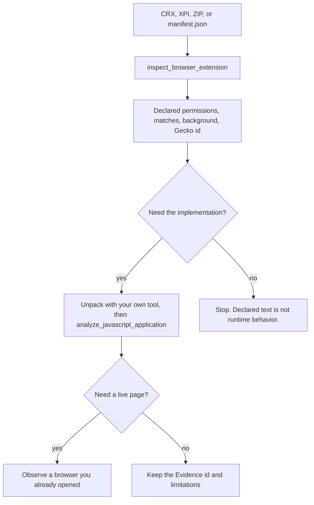
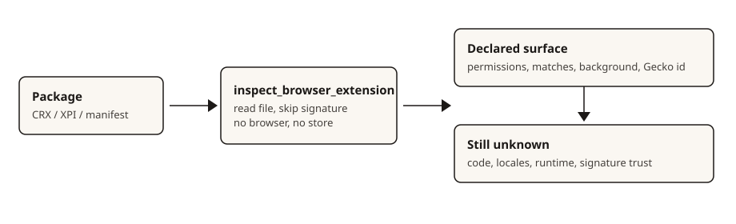

# Browser extension packages

`inspect_browser_extension` / `inspect-browser-extension` reads one explicit
local browser-extension package and returns its declared manifest surface.
It does not load the extension, contact a store, or verify a CRX signature.

Use it when the question is "what does this package declare?" A module graph,
content-script implementation, or live page behavior is a different question.
After this inspection, unpack the package yourself and use
[JavaScript application analysis](javascript-application-workflows.md), or
observe a browser you already have open with
[browser observation](browser-observation.md).

```sh
rea inspect-browser-extension ./extension.crx --json
rea inspect-browser-extension ./addon.xpi --json
rea inspect-browser-extension ./unpacked/manifest.json --json
```

```json
{
  "name": "inspect_browser_extension",
  "arguments": { "path": "/artifacts/extension.crx" }
}
```

MCP paths must be absolute filesystem paths on the current host. CLI paths
resolve against the operator's working directory. A directory is not an input.
Pass the CRX, XPI, ZIP, or the unpacked `manifest.json`.

## What is read

| Input | Recognition |
| --- | --- |
| `Cr24` version 2 | CRX2. Public-key and signature lengths are measured. Those bytes are not decoded or checked. |
| `Cr24` version 3 | CRX3. The header length is measured and skipped. The protobuf is not decoded. |
| ZIP local-file header | ZIP or XPI. Suffix is not required. |
| UTF-8 JSON file named `manifest.json` | Unpacked manifest. Other files in the directory are not opened. |

The ZIP payload must contain exactly one root `manifest.json`. A nested
`addon/manifest.json` or a second root `manifest.json` is a format failure.
Nested paths are named, up to three. Encrypted manifest entries are not read. Only store and
deflate entries that the bundled ZIP reader can expand are accepted. Other
archive members, including extension JavaScript, HTML, and `_locales`, stay
unexamined.

## Returned surface

The report distinguishes the package identity from the manifest identity. The
artifact SHA-256 covers the admitted file. The manifest SHA-256 covers
`manifest.json` bytes only.

Observed fields:

- `manifest_version` (`2`, `3`, or `other`)
- `name`, `version`, `description`, `default_locale`
- `permissions`, `optional_permissions`, `host_permissions`,
  `optional_host_permissions`
- content-script `matches`, `exclude_matches`, `js`, `css`, `run_at`, `world`,
  and `all_frames`
- background kind (`service_worker`, `scripts`, `page`, or `unknown`)
- Gecko id from `browser_specific_settings.gecko`, with a legacy
  `applications.gecko.id` retained as `conflicting_id` when the two ids differ
- action keys present among `action`, `browser_action`, and `page_action`
- content-security policy text
- `incognito`, side-panel presence, command names, web-accessible resource
  paths or entries, and `externally_connectable.matches`
- top-level keys that this projection does not interpret

`__MSG_*__` placeholders are listed in `message_keys` and left unresolved.
Locale catalogs are not opened.

## Workflow





Declared permissions are not grants. A content-script match is not proof the
script ran. A measured CRX header is not a verified signature. Missing fields
are absent from the manifest object that was parsed; they are not proof the
extension lacks a capability supplied another way.

## Limits and failures

Defaults are 64 MiB for the admitted file, 2 MiB for uncompressed
`manifest.json`, and 20,000 central-directory entries. The ceilings are 512
MiB, 8 MiB, and 100,000 entries. Exceeding a budget fails the inspection.
There is no partial manifest.

A relative path, a directory, a CRX version other than 2 or 3, a payload that
is not a ZIP, and a manifest that is not a UTF-8 JSON object are input
failures. The same CLI and MCP operation share this contract.

## Non-goals

This operation does not install an extension, launch a browser, inject a page,
download a store package, decode CRX protobuf signatures, resolve locale
messages, compare two packages, or parse extension JavaScript. Comparison of
two builds and locale resolution are separate questions.
